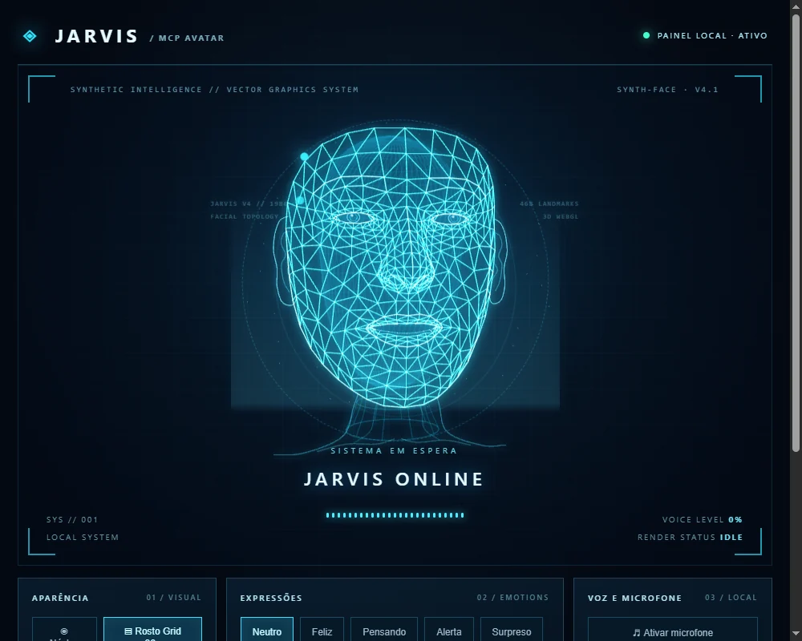

# JARVIS Desktop MCP · Protótipo 0.1

Avatar visual para Windows 10 com **dois modos** (núcleo energético e rosto holográfico), expressões, brilho de voz pelo microfone opcional e **controle por ferramentas MCP**, sem API paga de IA.

A inteligência e a conversa permanecem na janela oficial do ChatGPT; a interface gráfica é controlada por ferramentas MCP **quando conectadas e chamadas explicitamente**. O painel não lê o áudio nem as mensagens do ChatGPT automaticamente.

## JARVIS V4.1 — Humanoide 3D em wireframe azul



A **branch `feature/jarvis-v4-humanoid`** contém a V4.1 experimental, com geometria anatômica MediaPipe (468 vértices, 898 triângulos), malha e partículas WebGL/Three.js, olhos e orelhas detalhados, pescoço e expressões animadas. O visual preserva o conceito futurista dos anos 1980 e o modo núcleo, a voz e os comandos MCP.

[Ver o relatório técnico do refinamento](docs/v4.1-refinamento.md) · [Ver a referência estética original](assets/jarvis_humanoide_grid_conceito.webp)

**Importante:** o modelo V4.1 é um protótipo. Para compilar a partir das fontes, execute `npm ci` e `npm run build-v4`. O bundle WebGL já está incluído, portanto a execução local com `npm start` não exige download de bibliotecas. Esta versão **não foi mesclada na `main`** até sua aprovação final.

## Protocolo JARVIS — sessão visual em conversas por voz

A V4.2 experimental acrescenta **avatar ventríloquo silencioso**: sessão ouvindo, comando MCP de resposta pensando/falando e retorno automático a ouvindo. Não recebe, captura nem produz áudio. O som permanece no ChatGPT.

- Novas ferramentas MCP: `jarvis_voice_session` (ativar/desativar) e `jarvis_voice_turn` (estimativa de 1–60 segundos).
- Controles no painel para iniciar/encerrar sessão; microfone e voz local ficam desabilitados durante a sessão.
- Script local `scripts/jarvis-voice.ps1` para integração com o Desktop Commander já conectado ao ChatGPT, sem túnel adicional.
- **Não há garantia de chamadas automáticas em todos os turnos do modo Voz Live.** O controle é por ferramenta e os movimentos são uma aproximação visual, não lip-sync real.

[Leia a documentação do Protocolo JARVIS](docs/protocolo-jarvis-voz.md).

## JARVIS V4.4 — Rosto humanoide refinado

A V4.4 (branch experimental `feature/jarvis-v4.4-face-refinement`) preserva a topologia original MediaPipe e melhora **lábios, mandíbula, olhos, sobrancelhas, olhar de escuta e transições de expressão**. A interface mostra uma **barra real de inicialização WebGL com percentagem numérica** até 100%. O sincronismo do áudio local e a prioridade do MCP remoto continuam disponíveis. Veja [detalhes, testes e recuperação](docs/refinamento-v4.4.md).

## JARVIS V4.6 — Expressão natural e manutenção gráfica

A V4.6 (`feature/jarvis-v4.6-natural-face`) melhora o **fechamento dos lábios em repouso** e a abertura durante a fala, suaviza a leitura dos contornos internos e mantém a ligação com o MCP e a captura local de áudio. Acrescenta controle adaptativo de pixels no celular, recuperação de contexto WebGL e liberação de recursos gráficos. A **barra de carregamento continua com percentual numérico até 100%**. A V4.5 e versões anteriores foram preservadas em suas branches separadas.

[Consulte a implementação e os testes da V4.6](docs/refinamento-v4.6.md).

## JARVIS V4.7 — Olhar, expressões e acesso LAN com IP automático

A versão V4.7 está isolada em `feature/jarvis-v4.7-expression-dynamics`: implementa olhar com pausas naturais, piscadas de ritmo menos repetitivo e movimentos sutis de sobrancelhas, bochechas e cabeça durante a fala. A geometria original, o sistema MCP, o monitor de áudio Windows e a barra de progresso percentual permanecem preservados.

**Novo acesso LAN:** `iniciar-jarvis-rede.bat` descobre automaticamente o IPv4 privado atual do PC, evitando vincular o serviço a um IP antigo. Isso corrige a falha `EADDRNOTAVAIL` observada quando a Ethernet passou de `192.168.0.132` para `192.168.1.65`. O visualizador da porta 3767 continua somente leitura, sem comandos remotos nem exposição pública.

[Documentação e validação da V4.7](docs/refinamento-v4.7.md).

## Sincronização labial experimental por áudio de saída (V4.3)

O `scripts/jarvis-lipsync.py` captura exclusivamente amostras transitórias do dispositivo **padrão de saída do Windows** via loopback WASAPI, extrai somente a amplitude RMS e descarta imediatamente o áudio. Não há gravação, transcrição, rede externa nem captura de microfone. O daemon manda valores numéricos para `127.0.0.1:3766` com token local. O modelo 3D abre e fecha a boca com base nesses valores, independentemente de chamadas MCP por turno. Se o monitor de áudio parar, a fala não fica presa.

O monitor foi instalado em um ambiente Python isolado em `%LOCALAPPDATA%\\JarvisLipSync\\venv`. Com o painel iniciado na porta 3766, utilize `powershell -NoProfile -ExecutionPolicy Bypass -File .\\scripts\\start-lipsync.ps1 -Mode start`, `-Mode status` ou `-Mode stop`. Ative **Iniciar sessão visual** no painel. Verifique o indicador **PC · ÁUDIO WINDOWS ATIVO | CELULAR · MCP DISPONÍVEL**. Após a primeira instalação, atualize a aba no Chrome (F5) para carregar o novo bundle.

**Para iniciar os dois modos juntos na V4.3, use `iniciar-jarvis-dual.bat`**, na pasta do projeto. Ele inicia o avatar na porta 3766, reutiliza ou inicia o monitor de áudio do Windows e abre o Chrome, mantendo o inicializador antigo da porta 3765 inalterado.

**Dois modos ao mesmo tempo:** o JARVIS aceita a saída de áudio do PC e os comandos visuais MCP da conversa no celular. Durante uma resposta enviada pelo celular, a animação temporizada prevalece sobre o nível do Windows; ao terminar, o sincronizador local retoma automaticamente, sem ser desligado. A interface identifica qual fonte está em uso. **O modo Voz do ChatGPT ainda precisa acionar o MCP em cada resposta; esse disparo não é garantido pelo plugin do Chrome.**

**Limites:** é sincronismo de intensidade, não reconhecimento de fonemas. Como o loopback captura a **saída padrão inteira**, músicas, vídeos e outros aplicativos no mesmo dispositivo também podem mover a boca. Caso a voz do ChatGPT saia por outro dispositivo, ajuste a saída padrão do Windows. A conversa oficial do ChatGPT continua independente; o programa não recebe os eventos internos da voz do ChatGPT. É necessário iniciar o monitor novamente após reiniciar o PC; a inicialização automática não foi configurada.

## Acesso por outros aparelhos na rede local (visualização)

No PC, inicie `iniciar-jarvis-dual.bat` (porta 3766) e depois `iniciar-jarvis-rede.bat`. **O inicializador agora detecta automaticamente o IP privado atual** e mostra a URL para o celular, conectado à mesma rede. No teste de 25/10/2026, o endereço foi `http://192.168.1.65:3767/`, mas ele pode mudar. A porta 3767 continua apenas para visualização GET/SSE; o MCP permanece protegido no localhost. Veja [Acesso seguro pela rede local](docs/acesso-rede-local.md).

## Tela cheia — card do rosto do JARVIS

O card do rosto possui o botão **⛶ Maximizar**, no canto superior direito. O comando usa a Fullscreen API do navegador e amplia apenas o card (não o painel de controles), dimensionando o mesmo canvas 3D de forma responsiva. **Esc** ou **Restaurar** volta à visualização normal. Se a Fullscreen API não estiver disponível, usa expansão local reversível. A animação, o sincronismo labial e a sessão MCP continuam ativos. O botão funciona também no visualizador LAN, sem conceder permissão para alterar o estado remoto.

## Cabelo curto e sobrancelhas — Grid 3D animado

O avatar agora inclui um penteado masculino curto com leve topete, mechas penteadas para trás e laterais discretas, gerado como malha 3D holográfica azul. As sobrancelhas ganharam volume, contorno e fios geométricos que acompanham o rig de expressões faciais, preservando o sincronismo labial. **Não é uma imagem fotográfica ou uma sobreposição estática.** Consulte [os detalhes técnicos](docs/cabelo-sobrancelhas-grid.md).

## Orelhas e pescoço anatômicos — malha Grid 3D

O pavilhão auricular ganhou hélice, anti-hélice, concha, trago, antítrago, lóbulo e união com o crânio, com profundidade, espelhamento bilateral e linhas interconectadas. O pescoço deixou de usar anéis cilíndricos: agora possui malha frontal anatômica, esternocleidomastóideos, trapézios, tendões, laringe, clavículas e ombros em grid holográfico azul. **Não é uma imagem ou um rosto fotográfico**, e o sistema de expressões e lip-sync permanece inalterado. [Detalhes técnicos](docs/orelhas-pescoco-grid.md).

## V5.0 — rosto holográfico com proporções e iluminação naturais

A V5.0 preserva a malha MediaPipe original (468 pontos), mas acrescenta uma **superfície facial refinada por subdivisão**, iluminação suave tridimensional, olhos com volume e movimentos de cabeça mais orgânicos. A grade azul permanece visível, com menos brilho excessivo. O botão **Realismo anatômico** permite comparar a nova versão com o **Wireframe clássico** a qualquer momento; a escolha é lembrada no navegador. Não há câmera, áudio novo, login adicional ou inicialização automática no Windows. Detalhes, limitações e testes: [Refinamento V5.0](docs/refinamento-v5.md).

## Protocolo JARVIS carregável pelo MCP — personalidade Rafael

O documento autoral **`docs/JARVIS_PERSONALIDADE_MCP.md`** define o estilo conversacional de assistente tecnológico inspirado no JARVIS cinematográfico: voz verbal serena, humor contido, precisão técnica, tratamento por Rafael, sem se passar por outro modelo. O servidor `src/mcp-server.mjs` entrega o protocolo em `initialize.instructions`, `prompts/list` + `prompts/get` (prompt `jarvis-rafael`) e `resources/list` + `resources/read` (URI `jarvis://protocol/persona`). A ferramenta **`jarvis_activate_protocol`** ativa a sessão visual no PC se necessário e devolve o Markdown de personalidade para a conversa. O MCP da V4.9 usa a porta 3766 por padrão; para o painel legado, configure `JARVIS_PORT=3765`.

**Limite importante:** disponibilizar esse Markdown no MCP **não obriga todos os clientes a lê-lo na conexão** ou adotar a personalidade em cada conversa. A ativação depende de invocar o prompt/skill ou chamar `jarvis_activate_protocol`, quando as ferramentas estiverem disponíveis. O plugin privado **JARVIS — Protocolo Visual v0.4.0** contém instruções para responder nesse estilo quando for invocado. Não altera a configuração global do ChatGPT nem a inicialização do Windows.

## JARVIS V4.9 — expressões faciais por ritmo da fala (Classic + voz)

A V4.9 acrescenta expressividade automática discreta quando o monitor de saída de áudio do Windows está ativo: início de fala com concentração, pausas de pensamento, sorriso eventual e breves reações a ênfases de volume. **Esses sinais são puramente visuais e baseados no ritmo do som; não identificam o significado nem a emoção das palavras.** Quando o assistente envia um `mood` explícito via MCP, ou o usuário seleciona uma expressão no painel, esse comando prevalece.

No painel do PC, use **Expressões automáticas: ligadas/desligadas**, ou **Demonstrar 4 expressões (12 s)** para percorrer as quatro expressões sem alterar a voz do ChatGPT. A rede local mantém apenas visualização. O início com o Windows continua desativado e o projeto segue com inicialização manual.

## JARVIS V4.8 — PC, celular e operação manual

Na V4.8, **ambos os modos continuam disponíveis**: no PC, o áudio reproduzido no Windows controla a abertura dos lábios; pelo celular, comandos MCP acionam movimentos temporizados e expressões contextuais. O comportamento remoto é aproximado e não recebe áudio do telefone.

Para iniciar os três componentes manualmente (painel 3766, sincronizador e visualizador LAN 3767), execute **`iniciar-jarvis-manual.bat`**. Ele também ativa a sessão visual e abre o Chrome. Para verificar o estado sem alterar nada, execute `powershell -NoProfile -ExecutionPolicy Bypass -File .\scripts\diagnostico-jarvis.ps1`.

**Não existe instalação para iniciar com o Windows.** Essa opção fica reservada para o caso de o usuário solicitar futuramente. O visualizador LAN continua somente leitura; as expressões contextualizadas aceitam os humores `neutral`, `happy`, `alert`, `surprised` e `thinking`.

**Firewall (opcional, exige administrador):** execute manualmente `configurar-firewall-jarvis.bat` somente depois de verificar outras aplicações de rede; o Windows solicitará confirmação UAC. Esse comando liga o Firewall do perfil Privado e adiciona exceção restrita a TCP 3767, sem abrir o MCP. Para reverter alterações do JARVIS, consulte `scripts/reverter-firewall-rede.ps1`. A execução manual do JARVIS não altera o Firewall.

O [perfil de conversa JARVIS/Rafael](docs/perfil-jarvis-rafael.md) especifica linguagem objetiva e tratamento pessoal, mas a personalidade das respostas depende das instruções ativas no ChatGPT: o navegador é apenas o avatar silencioso.

## Executar no Windows 10

Requer Node.js 20+ e Edge/Chrome. Não necessita `npm install`.

1. Clone ou baixe este repositório em uma pasta própria, por exemplo `C:\Jarvis`.
2. Execute `iniciar-jarvis.bat` ou, no terminal, `npm start`.
3. Abra `http://127.0.0.1:3765`.
4. Alterne entre **Núcleo** e **Holograma**, teste expressões, clique em **Ativar voz local** e depois em **Testar resposta**. O microfone é opcional e independente.
5. Consulte `docs/integracao-mcp.md` para conectar um cliente MCP ao comando `node src/mcp-server.mjs`.

## Funcionalidades

- Rosto holográfico e núcleo circular com animações locais.
- Expressões e estado visual controlados pelo painel e por doze ferramentas MCP (incluindo controle de sessão, resposta visual e sincronismo local).
- Síntese de voz local em português no Chrome/Edge, ativada manualmente; a nova legenda recebida via MCP pode ser lida em voz alta.\n- Efeito de áudio com permissão do microfone (apenas volume local, sem gravação).
- Servidor HTTP em `127.0.0.1` com atualizações SSE.
- MCP por stdio; sem necessidade de API da OpenAI.

## Limitações

Este é um **protótipo de interface**, não um aplicativo `.exe` nem um assistente independente. Não intercepta a conversa do ChatGPT, não reproduz sua voz automaticamente e não controla o Windows. A configuração do MCP no cliente ainda é necessária. Consulte `docs/integracao-mcp.md` para conectar via STDIO no ChatGPT Desktop compatível ou via túnel no ChatGPT web.\n\n**Observação:** a voz do avatar é gerada pelo navegador e não é o áudio da voz do ChatGPT.

## Segurança

O servidor principal e os comandos MCP continuam restritos a `127.0.0.1` e utilizam token local. O visualizador separado da porta 3767 atende exclusivamente HTTP GET/SSE em um IP privado da LAN; não fornece acesso a comandos de controle. Não encaminhe portas pelo roteador nem exponha o serviço diretamente à internet. Nunca publique arquivos com senhas ou tokens e evite dados confidenciais nas legendas.

Os projetos LexJuridicus, Codex e Desktop Commander **não são alterados**.

## Testes

```powershell
npm test
```

**Autoria e direitos autorais:** Copyright © 2026 Rafael Passos — Engenharia de Software, IA e Segurança da Informação.

Licença MIT.
