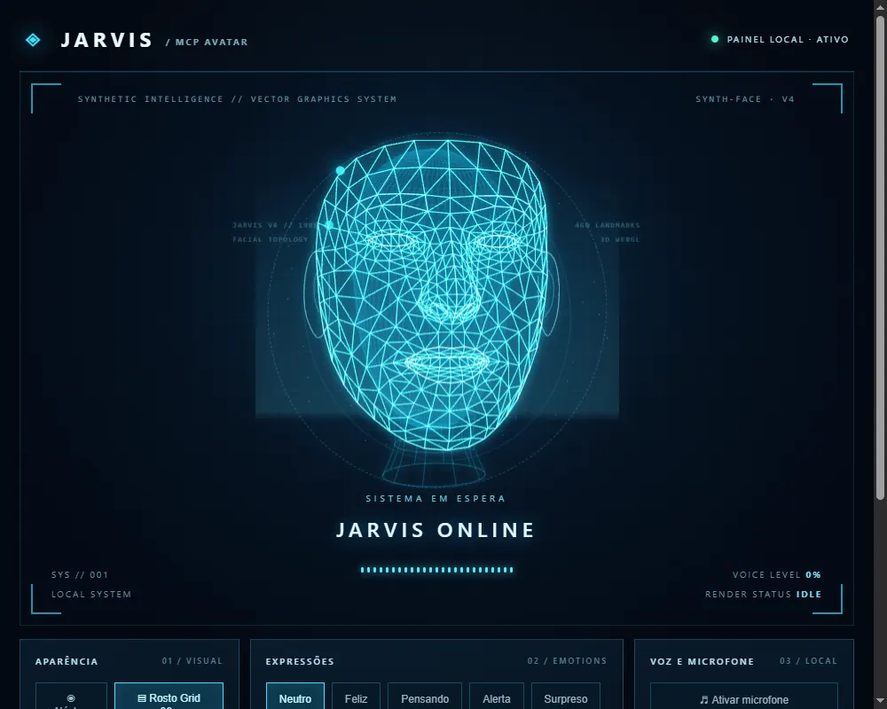

# JARVIS V4 — Fase 2: protótipo 3D humanoide

**Situação:** protótipo desenvolvido **somente** em `feature/jarvis-v4-humanoid`. A `main` não foi alterada.

## O que mudou

1. **Modelo facial 3D anatômico real:** a malha canônica MediaPipe fornece 468 pontos e 898 triângulos com a geometria de olhos, nariz, boca e mandíbula.
2. **Motor gráfico único:** renderização Three.js/WebGL com linhas triangulares, pontos de vértice, brilho ciano e animação 3D; removidos os dois renderizadores Canvas 2D faciais duplicados.
3. **Detalhes do rosto:** contornos seguindo índices anatômicos MediaPipe; crânio traseiro, orelhas e pescoço complementares paramétricos (não parte do modelo original).
4. **Expressões:** neutro, feliz, surpreso, alerta e piscada; a boca movimenta-se de forma aproximada conforme o estado de fala do painel. Não é sincronização fonema-a-fonema.
5. **Modo núcleo e áudio preservados:** permanecem o núcleo circular, o microfone opcional, a voz nativa pt-BR do navegador, os botões e as sete ferramentas MCP.
6. **Fallback:** se não houver WebGL ou houver falha de carregamento da malha, o painel exibe a prévia estática com mensagem de erro.
7. **Build offline:** `esbuild` incorpora Three.js em `public/face-v4.bundle.js`. Nenhuma CDN, API paga ou serviço externo é necessário em execução.
8. **Isolamento de tokens para portas alternativas:** `3766` usa token `.jarvis-desktop-mcp-token-3766`, sem sobrescrever o token padrão usado na porta `3765`.

## Testes executados

- `npm test` — **5 testes aprovados**, 0 falhas.
- `node --check` do JavaScript, build esbuild — passaram.
- Interface inicial abriu em navegador Chrome headless no Windows com WebGL e renderizou a face.
- Rotas `/`, `/face-v4.bundle.js` e `/assets/models/canonical-face.json` verificadas.
- Rejeição de operações de controle sem token e chamadas manuais sem cabeçalho/origem permitidos, confirmada em testes.
- A captura pode ser consultada em `docs/v4-preview.webp`.



## Como testar **sem alterar o Jarvis atual**

Da pasta da branch V4:

```powershell
npm ci
npm run build-v4
$env:JARVIS_PORT="3766"
npm start
```

Abra `http://127.0.0.1:3766/`. A instalação habitual em `127.0.0.1:3765` pode continuar aberta. Reinicie o processo da porta de teste após o build.

**Aviso de privacidade:** não publicar a porta na Internet nem inserir dados privados nas legendas. Os controles manuais existentes ainda precisam de uma autenticação mais robusta antes de qualquer extensão remota.

## Licenças

- Google MediaPipe canonical face: **Apache License 2.0** (fonte e licença em `assets/models/` e `third_party/`).
- Three.js: **MIT** (texto copiado em `third_party/three-MIT.txt`).
- Esbuild: MIT, ferramenta de build.
- Consulte `third_party/ATTRIBUTIONS.md`.

## Próximas validações (antes de mesclar)

- Avaliação visual pelo responsável: proporções faciais, olhos, nariz, mandíbula e orelhas.
- Testar todas as expressões e fala com áudio real no Windows/Chrome.
- Medir uso de CPU/GPU e comportamento em computadores sem WebGL.
- Testar comunicação com cliente MCP externo/túnel (não incluída nesta etapa).
- Consolidar CSS legado e reforçar autenticação manual se o projeto for distribuído.

**Não realizar merge na main sem aprovação visual explícita.**
